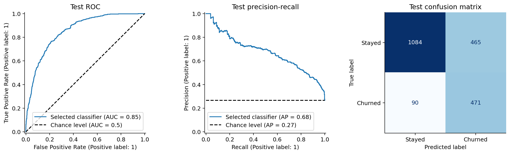

# Customer Churn Prediction and Retention Analysis

We built a machine learning workflow to identify telecom customers who are likely to leave. We explored customer and service patterns, engineered features, compared classifiers, and examined how estimated churn risk could guide retention spending.

This is a **Machine Learning course project at Sharif University of Technology**, taught by **Ali Sharifi Zarchi**.

**Team:** Setayesh Heydari, Amir Hossein Shahrabi, Amir Abbas Donyadideh, and Bardia Soltani Moakhar.

[Analysis notebook](notebooks/customer_churn_analysis.ipynb) · [English report (PDF)](reports/customer_churn_report.pdf) · [English report (Markdown)](reports/report.md)

## Main results

Five-fold cross-validation on the training split selected a tuned random forest with SMOTE. On the held-out test split of 2,110 customers, the selected classifier identified 471 of 561 churn cases.

| Test metric | Result |
| --- | ---: |
| Churn recall | 84.0% |
| Churn precision | 50.3% |
| Churn F1 | 0.629 |
| ROC-AUC | 0.855 |
| Average precision | 0.676 |

At the 0.50 classification threshold, this model flagged 936 customers, including 465 who stayed. It favors finding churn cases over limiting contacts. An always-stay baseline reaches 73.4% accuracy while finding no churn cases, so we use recall, precision and F1 to assess the tradeoff.

## What we studied

- **Customer patterns:** churn by contract, tenure, billing and service characteristics.
- **Feature engineering and selection:** tenure bands, a cumulative-charge/tenure ratio and service count; feature ranking with chi-squared/ANOVA scores, Lasso and random-forest importance.
- **Classification:** logistic regression, KNN, random forest, gradient boosting and soft voting; class weighting, SMOTE and grid search.
- **Retention costs:** a scenario that compares no action and two offers using calibrated churn probabilities and stated cost/success assumptions.

## Data and evaluation

The [IBM Telco Customer Churn sample](https://www.kaggle.com/datasets/blastchar/telco-customer-churn) has 7,043 rows and 21 columns. We remove 11 rows with blank `TotalCharges`, leaving 7,032 customers. We exclude `customerID` from prediction and encode `Churn` as 1 for `Yes` and 0 for `No`. See [dataset details](data/DATASET.md) for provenance and the verified checksum.

We reserve 30% for testing with a stratified split (`random_state=40`). All model comparisons use five stratified folds of the remaining 70% (`random_state=42`). Imputation, encoding, scaling, feature selection and SMOTE are fitted within each training fold. The model-selection rule maximizes mean CV recall among candidates with mean CV F1 at least 0.50. The test set is excluded from that rule.

Training cross-validation results:

| Model | CV recall | CV F1 | CV ROC-AUC |
| --- | ---: | ---: | ---: |
| Tuned random forest + SMOTE | 0.808 | 0.623 | 0.837 |
| Logistic regression (balanced) | 0.799 | 0.626 | 0.837 |
| Tuned logistic regression + SMOTE | 0.797 | 0.627 | 0.837 |
| Logistic regression + SMOTE | 0.797 | 0.627 | 0.837 |
| Gradient boosting | 0.514 | 0.573 | 0.837 |
| KNN | 0.502 | 0.552 | 0.819 |
| Soft voting | 0.496 | 0.564 | 0.840 |
| Logistic regression | 0.488 | 0.557 | 0.837 |
| Random forest | 0.483 | 0.555 | 0.838 |

The full [fold scores](reports/results/cross_validation_folds.csv), [feature ranks](reports/results/feature_ranking.csv), [split indices](reports/results/split_indices.csv) and [experiment summary](reports/results/summary.json) are included. Search scores are development estimates after tuning; the test figures above are the final evaluation for this experiment.

## Retention scenario and limits

The scenario assumes a USD 500 churn loss, offer costs of USD 50 and USD 100, and success rates of 30% and 60%. Expected loss is `p * loss` without action and `p * (1 - success) * loss + offer_cost` with action. The same baseline applies to all actions. Under these assumptions, the low-cost offer is never uniquely optimal; the targeted policy chooses no action or the high-cost offer.

The [scenario totals](reports/results/retention_scenario.csv) are model-based illustrations, not measured savings or profit. These data contain no treatment outcomes. We would need current probability checks, an intervention experiment and validated business costs before using this policy in a campaign.

The dataset is a public snapshot used during coursework. A random holdout is not a future-period or independent external evaluation. Ordinary SMOTE can produce fractional one-hot values; class weighting avoids that issue. Feature ranks describe predictive associations and may shift across samples. Zero-tenure customers are outside the evaluated subset.

## Sources and license

- [IBM source repository and dataset](https://github.com/IBM/telco-customer-churn-on-icp4d)
- [Kaggle dataset page used in the coursework](https://www.kaggle.com/datasets/blastchar/telco-customer-churn)
- [imbalanced-learn: resampling and data leakage](https://imbalanced-learn.org/stable/common_pitfalls.html)
- [scikit-learn: probability calibration](https://scikit-learn.org/stable/modules/calibration.html)

Code and documentation are released under the [MIT license](LICENSE). Dataset terms remain with the original source.
