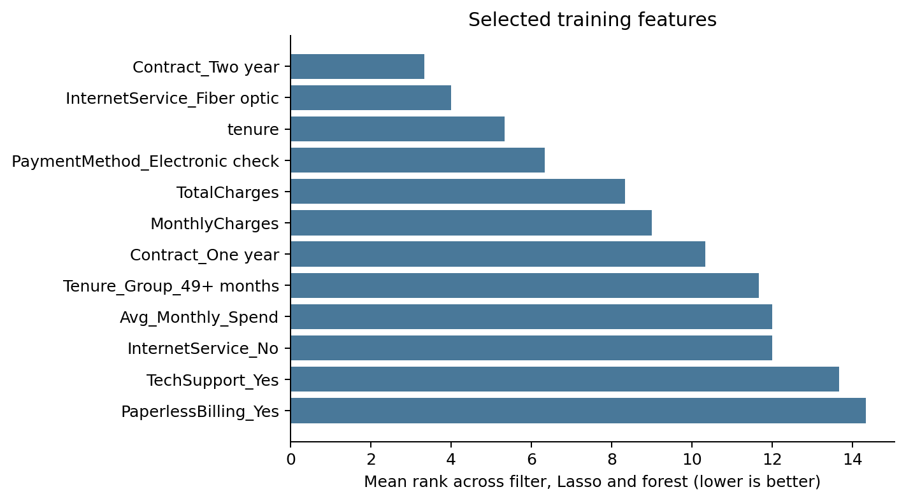

# Customer Churn Prediction and Retention Analysis

Machine Learning course project | Sharif University of Technology

**Instructor:** Ali Sharifi Zarchi

**Team:** Setayesh Heydari; Amir Hossein Shahrabi; Amir Abbas Donyadideh; Bardia Soltani Moakhar.

## 1. Project overview

We built a classification workflow to identify telecom customers who are likely to leave. We examined customer characteristics and service choices, created interpretable features, compared several classifiers, and connected estimated churn risk to a retention-cost scenario.

We used the IBM Telco Customer Churn sample, which contains 7,043 customer records. After removing 11 records with blank total charges, we retained 7,032 customers. We reserved 30% for testing and used the remaining 70% for exploration, feature selection, model comparison and parameter tuning.

Our selection rule favors recall because missing a customer who leaves matters for retention planning. We require mean cross-validation F1 of at least 0.50, then choose the candidate with the highest mean recall. This rule selected a tuned random forest trained with SMOTE. All numerical results below come from the executable analysis in this repository.

### Main test results

| Measure | Value |
| --- | ---: |
| Test customers | 2,110 |
| Observed churn cases | 561 |
| Correctly identified churn cases | 471 |
| Churn recall | 83.96% |
| Churn precision | 50.32% |
| Churn F1 | 0.6293 |
| ROC-AUC | 0.8547 |

The model identified 471 of 561 churn cases, while flagging 465 customers who stayed. This tradeoff suits a high-recall screening exercise, but it would require campaign-capacity and cost checks before practical use.

The retention analysis uses hypothetical intervention costs and success rates. Its outputs are expected losses and savings under those assumptions; the dataset contains no treatment outcomes from which to estimate actual retention effects.

<!-- pagebreak -->

## 2. Dataset, cleaning and exploratory analysis

Each row describes one customer. The target, `Churn`, records whether the customer left the service. We encode `Yes` as 1 and `No` as 0. The unique `customerID` is retained only for data checks and is excluded from prediction.

| Information | Raw columns |
| --- | --- |
| Customer profile | gender, SeniorCitizen, Partner, Dependents |
| Account and billing | tenure, Contract, PaperlessBilling, PaymentMethod, MonthlyCharges, TotalCharges |
| Subscribed services | PhoneService, MultipleLines, InternetService, OnlineSecurity, OnlineBackup, DeviceProtection, TechSupport, StreamingTV, StreamingMovies |

### Data checks

The verified sample contains no exact duplicate rows or duplicate customer identifiers. `TotalCharges` is a text column: numeric conversion reveals 11 blank entries. These customers all have zero tenure. We remove these 11 records, leaving 5,163 non-churn customers and 1,869 churn customers, a churn share of 26.58%.

This complete-charge subset follows the coursework's modeling population. It means that the reported evaluation does not cover customers at zero tenure. Numerical median imputation and categorical mode imputation remain in the fitted pipeline for missing values in model inputs.

We use a stratified 70/30 split with seed 40: 4,922 training records and 2,110 test records. Exploratory plots and feature diagnostics in this repository use the training records. The test labels are excluded from transformation fitting, feature ranking and model selection.

### Observed patterns in the training sample

| Contract | Observed churn rate |
| --- | ---: |
| Month-to-month | 42.2% |
| One year | 12.4% |
| Two year | 2.9% |

Month-to-month customers have the highest churn rate in this sample. Tenure distributions also differ between customers who left and customers who stayed. These patterns motivated tenure bands and contract indicators. They describe associations; they do not establish that changing a contract will prevent churn.

The notebook includes class-count, contract-rate and tenure-distribution plots. We calculate rates within each group so that differences in group size do not get mistaken for differences in churn risk.

<!-- pagebreak -->

## 3. Feature engineering and selection

We create three features independently for each customer before fitting any statistical transformation.

| Feature | Definition and purpose |
| --- | --- |
| Tenure_Group | Four tenure bands: 0-12, 13-24, 25-48 and 49+ months. They allow tenure to have a non-linear association with churn. |
| Avg_Monthly_Spend | TotalCharges / (tenure + 1). This summarizes cumulative charges relative to tenure. It is not a measure of spending growth. |
| Service_Count | Number of seven add-on services recorded as Yes: multiple lines, online security, online backup, device protection, tech support, streaming TV and streaming movies. |

Within each training fold, we fit median/mode imputers, standardize numerical inputs and one-hot encode categorical inputs with one reference category dropped. Unknown categories are handled without changing the fitted feature dimension.

### Ranking the encoded features

We combine three rankings: a filter score formed by averaging normalized chi-squared and ANOVA F scores; absolute coefficients from LassoCV on standardized encoded inputs; and impurity-based importance from a balanced random forest. We average their ranks and retain the 12 columns with the lowest mean rank. Lasso treats the binary target as a numeric response solely for feature screening.

Selection is refitted inside every outer training fold. The diagram below shows the ranking after fitting the selected pipeline on the full training partition. Fold-specific selected subsets may differ.

Filter scores are screening heuristics, not adjusted significance tests. Correlated billing variables share information, and impurity importance can favor some feature types. Rank agreement does not prove a causal relationship or guarantee that the subset is optimal.

<!-- pagebreak -->

## 4. Models, imbalance and validation

We compare logistic regression, KNN, random forest, gradient boosting and a soft-voting ensemble. The ensemble averages probabilities from logistic regression, random forest and gradient boosting. Logistic regression is also evaluated with balanced class weights and with SMOTE.

For every candidate, a pipeline fits preprocessing and the 12-feature selector using only the current training fold. For SMOTE candidates, synthetic minority records are then generated inside that fold. Validation and test partitions retain their original class distribution. Ordinary SMOTE can create fractional encoded indicators, which limits how literally its synthetic customers can be interpreted.

### Five-fold training cross-validation

All candidates use the same shuffled stratified folds with seed 42. Recall, precision, F1, ROC-AUC and average precision are recorded for the churn class. We select by mean recall subject to mean F1 >= 0.50, breaking ties by F1 and then model name. SD denotes the standard deviation across folds.

| Model | Recall | SD | F1 | ROC-AUC |
| --- | ---: | ---: | ---: | ---: |
| Tuned random forest + SMOTE | 0.808 | 0.022 | 0.623 | 0.837 |
| Logistic regression (balanced) | 0.799 | 0.012 | 0.626 | 0.837 |
| Tuned logistic regression + SMOTE | 0.797 | 0.011 | 0.627 | 0.837 |
| Logistic regression + SMOTE | 0.797 | 0.011 | 0.627 | 0.837 |
| Gradient boosting | 0.514 | 0.035 | 0.573 | 0.837 |
| KNN | 0.502 | 0.065 | 0.552 | 0.819 |
| Soft voting | 0.496 | 0.041 | 0.564 | 0.840 |
| Logistic regression | 0.488 | 0.040 | 0.557 | 0.837 |
| Random forest | 0.483 | 0.045 | 0.555 | 0.838 |

### Parameter search

The logistic-regression search includes C = 0.01, 0.1 and 1.0, with L2/lbfgs or L1/liblinear, for six valid combinations. The random-forest search includes 100/200 trees, depth 4/8, gini/entropy criteria and sqrt feature sampling, for eight combinations. Both searches include SMOTE and use the same five training folds and selection rule.

The selected forest uses 100 trees, depth 4, entropy and sqrt feature sampling. Its mean CV recall is 0.808 and mean CV F1 is 0.623. Balanced logistic regression is a close alternative, with mean recall 0.799 and F1 0.626. The selection rule prioritizes the forest's recall; it does not establish statistical superiority over nearby candidates.

Search and comparison scores are development estimates after model choice. They can be optimistic and are not nested-CV estimates. The test split is reserved from the fitting and selection performed in this experiment.

<!-- pagebreak -->

## 5. Held-out test results and probability checks

After choosing the model, we fit its pipeline on the 4,922 training customers. We evaluate the resulting classifier on 2,110 test customers at its default 0.50 threshold. We do not tune that threshold using test labels.

| Metric | Selected classifier | Always-stay baseline |
| --- | ---: | ---: |
| Accuracy | 0.7370 | 0.7341 |
| Churn precision | 0.5032 | 0.0000 |
| Churn recall | 0.8396 | 0.0000 |
| Churn F1 | 0.6293 | 0.0000 |
| ROC-AUC | 0.8547 | 0.5000 |
| Average precision | 0.6757 | 0.2659 |

The two classifiers have similar accuracy, but very different behavior. The always-stay baseline finds no churn cases. The selected classifier finds 471 cases, misses 90, and raises 465 false alarms. Its precision means that about half of flagged customers churned in the observed sample.

### Confusion matrix

| Actual outcome | Predicted stay | Predicted churn |
| --- | ---: | ---: |
| Stayed | 1,084 | 465 |
| Churned | 90 | 471 |

### Probabilities used in the cost scenario

We fit a separate sigmoid-calibrated version of the selected pipeline using three stratified folds of the training data, with seed 43. Each calibration fold has natural class prevalence; preprocessing, selection and SMOTE remain inside the corresponding model-fitting fold. The final test is used only to assess the resulting probabilities.

Brier loss decreases from 0.1650 for the classifier's raw scores to 0.1327 for the calibrated model. Lower Brier loss is better; this comparison reflects both calibration and averaging the three fitted models. The calibrated model's test ROC-AUC is 0.8553. Classification results above belong to the original selected classifier; the retention scenario uses the separate calibrated probabilities.

The notebook contains ROC, precision-recall, confusion-matrix and calibration plots. The test set is a random subset of a public coursework dataset, so these results do not establish performance on a later period or a new customer population.

<!-- pagebreak -->

## 6. Retention decisions under stated assumptions

We compare no action, a low-cost offer and a high-cost offer. Let p be calibrated churn probability, L the loss if the customer leaves, c the cost of an offer, and s the fraction of otherwise-churning customers retained by that offer. We assume that the offer cost is paid for every targeted customer.

| Input | Assumed value |
| --- | ---: |
| Loss per churned customer | USD 500 |
| Low-cost offer: cost / success | USD 50 / 30% |
| High-cost offer: cost / success | USD 100 / 60% |

Expected loss without an offer is **p * L**. Expected loss with an offer is **p * (1 - s) * L + c**. The incremental expected saving is **p * s * L - c**. Comparing actions on this common loss baseline prevents avoided-loss benefits from being confused with total profit.

We choose the action with the smallest expected loss for each test customer, with no budget or capacity constraint. Aggregating those choices gives:

| Strategy | Expected loss (USD) | Savings vs. no action (USD) |
| --- | ---: | ---: |
| none | 285,270.51 | 0.00 |
| low all | 305,189.35 | -19,918.85 |
| high all | 325,108.20 | -39,837.70 |
| targeted | 235,592.62 | 49,677.88 |

The targeted policy assigns 1,322 customers to no action, none to the low-cost offer and 788 to the high-cost offer. The estimated USD 49,677.88 saving is a conditional scenario result for these 2,110 records, not measured business revenue or realized profit.

### Why the low-cost offer is never uniquely selected

Its incremental saving is 150p - 50. The high-cost offer's saving is 300p - 100, exactly twice that amount. For p below 1/3, both offers lose money relative to no action. For p above 1/3, the high-cost offer has the larger saving. At p = 1/3 the actions tie; the code resolves the tie in favor of no action. The low-cost offer therefore cannot be uniquely optimal under these assumptions.

These success rates are not learned from the churn dataset. Estimating intervention effects would require treatment outcomes or a controlled experiment. A practical policy would also need current probability validation, measured costs, a campaign budget and a review of how benefits vary across customers.

<!-- pagebreak -->

## 7. Reproducibility, scope and references

### Reproduce the experiment

From the repository root, create a Python 3.12 environment, install the pinned versions in `requirements.txt`, then install the local package with `python -m pip install -e .`. Run `python -m telco_churn.data` to retrieve the verified IBM sample, followed by `python -m telco_churn.experiment`.

For the notebook, install `python -m pip install -e ".[notebook]"` and open `notebooks/customer_churn_analysis.ipynb`. Run every cell in order. The notebook shows the same split, candidate comparison, feature rankings, test results and retention equations as the source modules.

The raw data checksum, seeds, package versions and final metrics are recorded in `reports/results/summary.json`. Source-row split assignments, fold scores, feature ranks and scenario totals are included as CSV files. The downloaded data, caches, model bundle and customer-level predictions are excluded from version control.

To rebuild this PDF from the Markdown report, install the report extra with `python -m pip install -e ".[report]"` and run `python scripts/build_report.py`.

### Checks and limits

The project checks cover derived-feature definitions, immutable input handling, cost arithmetic, probability validation, the recall/F1 selection rule, and preprocessing fitted on training folds. They check the implementation rather than establish external predictive validity.

This public snapshot was used during coursework. The random split is not a time-based backtest or an independent external evaluation. It omits zero-tenure customers. All comparisons depend on the feature selector, chosen parameter grids and default decision threshold. Ordinary SMOTE can create fractional categorical indicators, and feature ranks can vary with the sample. Calibration on the training population does not ensure calibrated probabilities after a population shift.

The cost analysis has no estimated treatment effects and no budget constraint. Its role is to make the financial assumptions explicit enough to inspect and change.

### References

1. IBM. Telco Customer Churn sample and source repository. [IBM repository](https://github.com/IBM/telco-customer-churn-on-icp4d).
2. Kaggle. Telco Customer Churn dataset used in the coursework. [Dataset page](https://www.kaggle.com/datasets/blastchar/telco-customer-churn).
3. imbalanced-learn. Common pitfalls and recommended practices: resampling within evaluation pipelines. [Documentation](https://imbalanced-learn.org/stable/common_pitfalls.html).
4. scikit-learn. Probability calibration. [Documentation](https://scikit-learn.org/stable/modules/calibration.html).

The repository's MIT license applies to its code and documentation. Dataset terms remain with the source.
